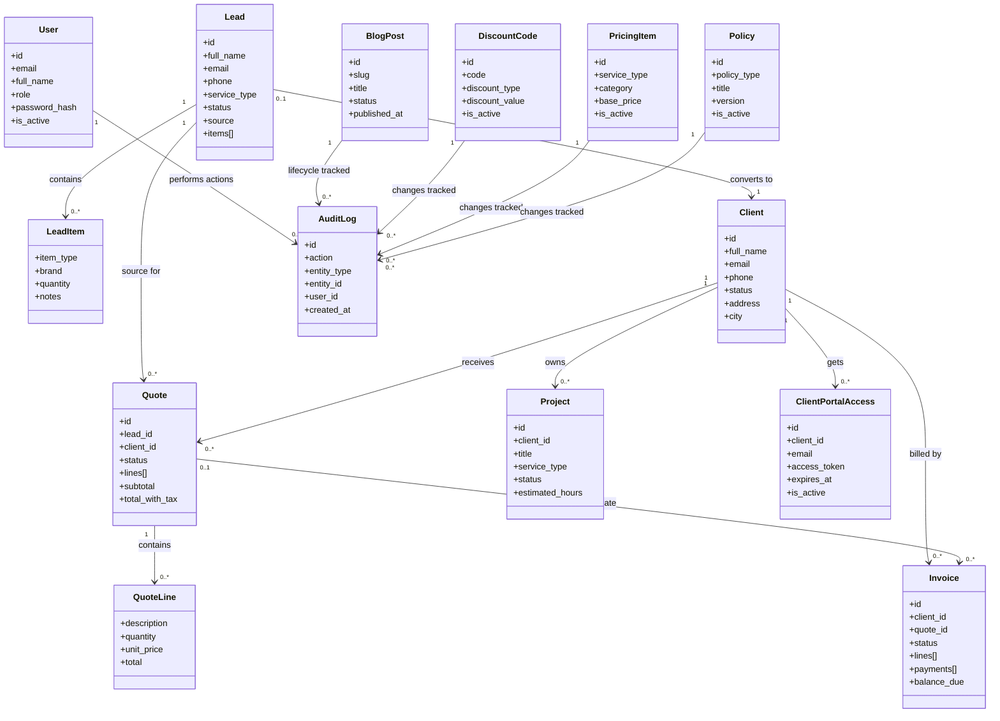
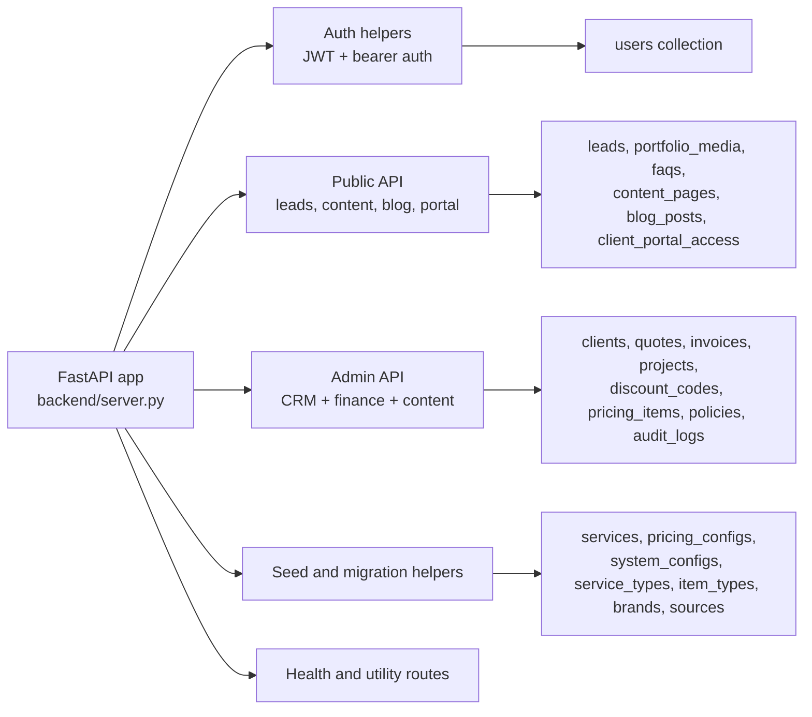

# Backend Domain Model

The backend is organized as one FastAPI module with several domain clusters. The diagram below focuses on the main persistent entities and the relationships the API exposes.

## Backend module clusters

## Notes

- The entity list mirrors Pydantic models declared in `backend/server.py`, including `Lead`, `Client`, `Quote`, `Invoice`, `Project`, `ClientPortalAccess`, `BlogPost`, `DiscountCode`, `PricingItem`, `Policy`, and `AuditLog`.
- Relationship direction follows the API behavior. For example, `POST /api/v1/admin/leads/{lead_id}/convert-to-client` turns a lead into a client, and portal records are created through `POST /api/v1/admin/clients/{client_id}/portal-access`.
- Audit logging is a cross-cutting concern implemented through `create_audit_log(...)` and reused across login, CRUD, blog, portal, pricing, policy, and invoice flows.
