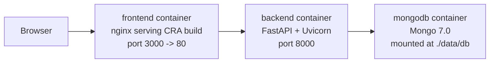
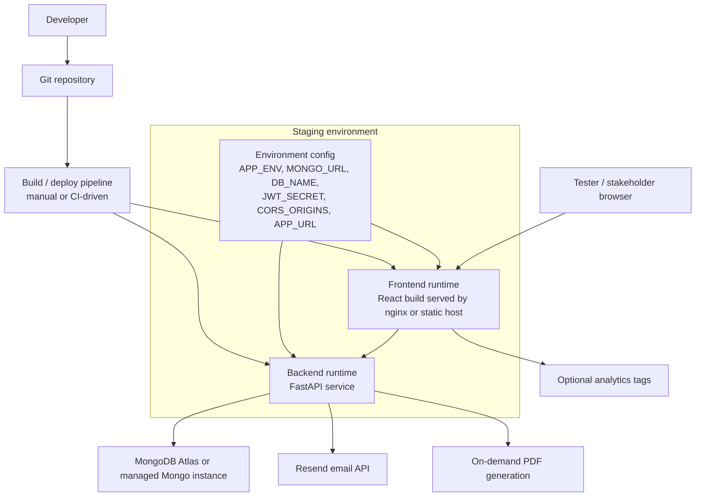
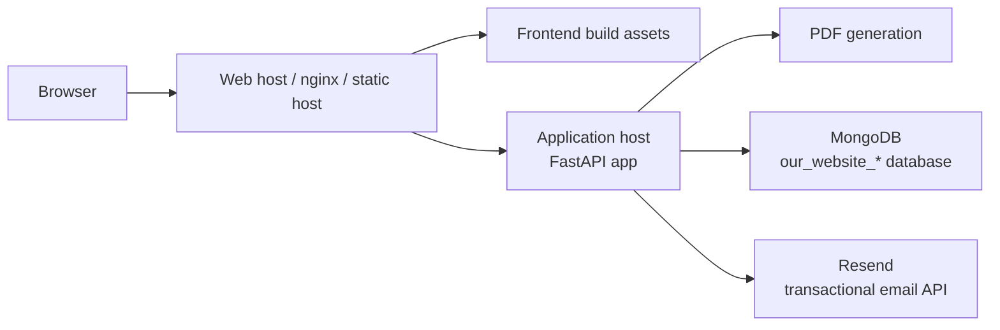

# Deployment And Staging

The repository currently documents two important runtime shapes:

- local development with Docker Compose
- a production or staging-style deployment with frontend, backend, and MongoDB/Atlas separated by environment variables

## Local Docker topology

Local shape is derived from `docker-compose.yml`.

## Target staging topology

## Deployment view

## Notes

- `docker-compose.yml` shows the local composition of MongoDB, backend, and frontend.
- `docker-compose.prod.yml` shows the environment variables expected by the backend and frontend for a hosted environment.
- `PRODUCTION_DEPLOYMENT.md` documents Atlas-backed deployment and data migration, which is why the staging diagram treats MongoDB as an external managed dependency.
- The frontend currently consumes backend URLs from `REACT_APP_BACKEND_URL` in code even though compose examples mention `REACT_APP_API_URL`, so environment coordination matters in staging.
