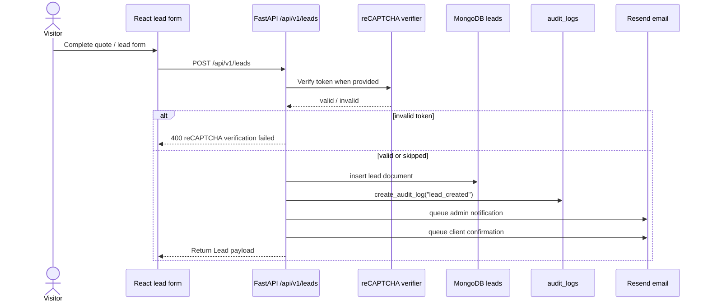
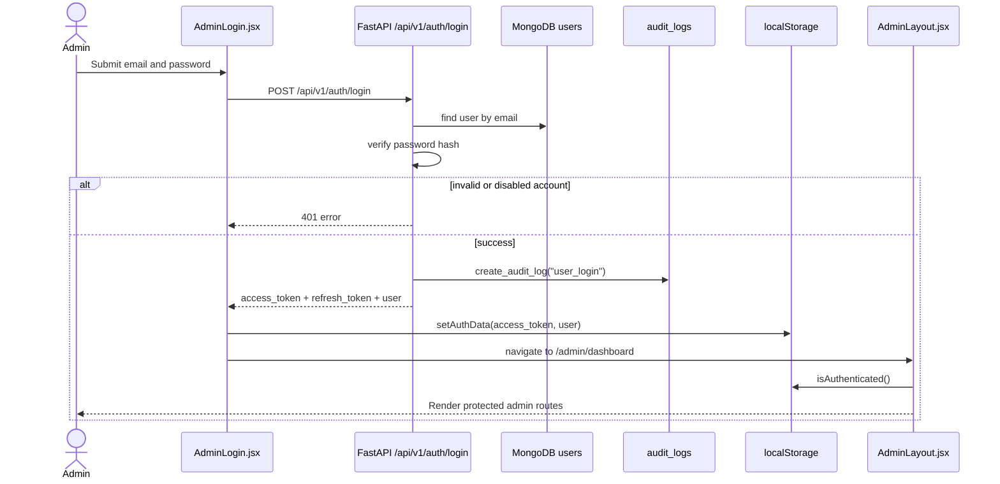
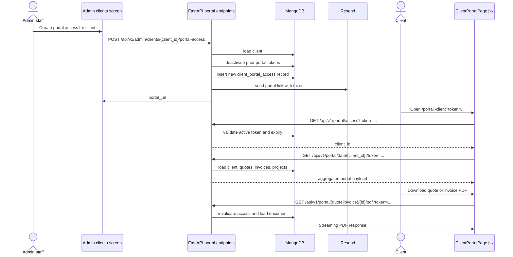

# Key Request Flows

These sequence diagrams document the highest-value behaviors shared across the public site, admin area, and client portal.

## Public lead submission

Based on `create_lead(...)` in `backend/server.py` and the shared API client in `frontend/src/lib/api.js`.

## Admin login and protected admin access

Based on:

- `frontend/src/pages/admin/AdminLogin.jsx`
- `frontend/src/components/layout/AdminLayout.jsx`
- `frontend/src/lib/utils.js`
- `backend/server.py` login and auth helper functions

## Client portal invitation and portal data access

Based on:

- portal access endpoints in `backend/server.py`
- `frontend/src/pages/ClientPortalPage.jsx`
- shared portal API helpers in `frontend/src/lib/api.js`

## Flow observations

- Public and admin flows both depend on the same backend service, but only admin routes require JWT bearer authentication.
- The client portal uses tokenized access records in MongoDB instead of admin JWTs.
- Email and audit logging are side effects that recur across lead capture, login, CRUD changes, and portal access issuance.
