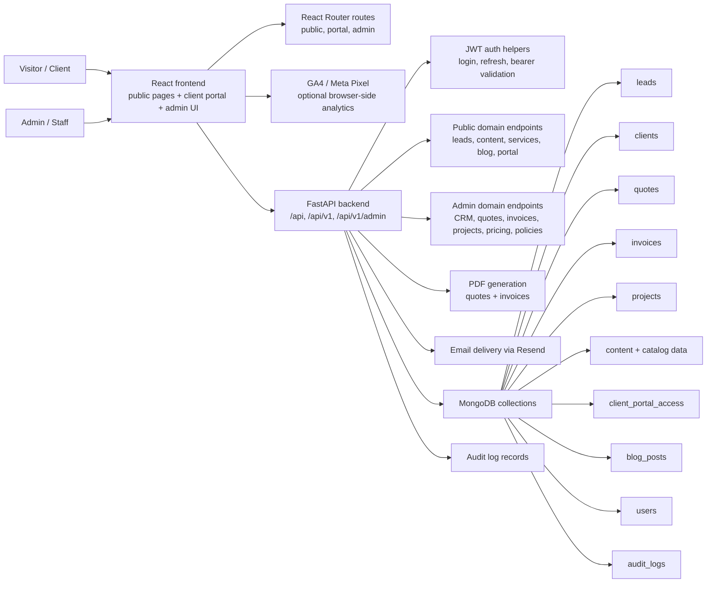

# System Overview

This diagram shows the main runtime components and how the app is split between public site, admin tooling, API, and supporting services.

## Notes

- The route split comes from `frontend/src/App.js`, which defines public pages, a client portal route at `/portail-client`, and protected admin routes under `/admin`.
- The frontend talks to the backend through a shared Axios client in `frontend/src/lib/api.js`.
- Backend responsibilities are concentrated in `backend/server.py`, which defines Pydantic models, authentication helpers, API routers, PDF generation, seed flows, and collection access.
- Optional analytics are initialized in `frontend/src/App.js` through `REACT_APP_GA4_ID` and `REACT_APP_META_PIXEL_ID`.
